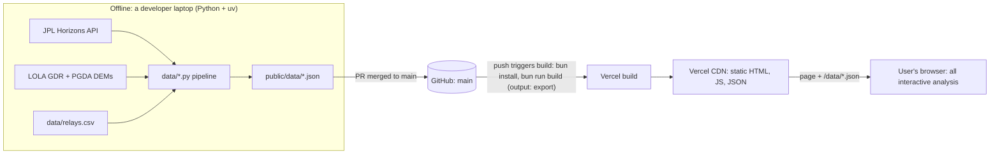
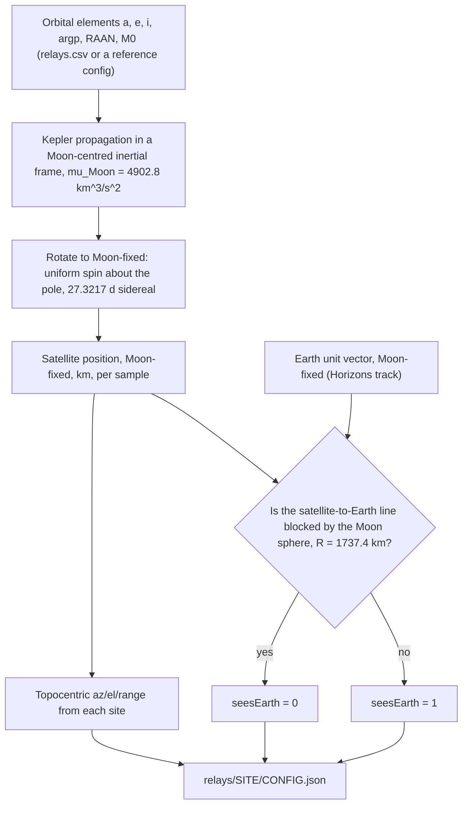
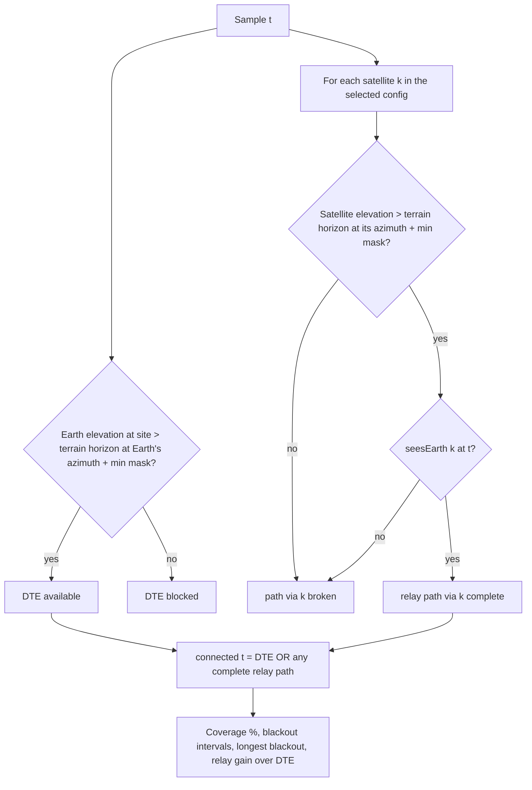
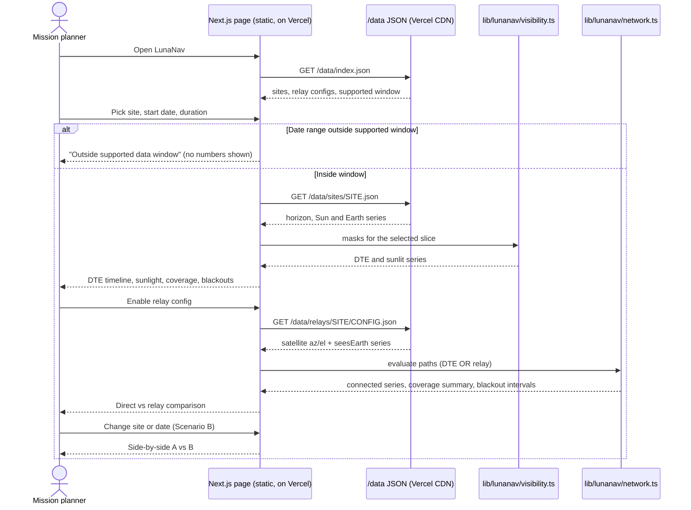
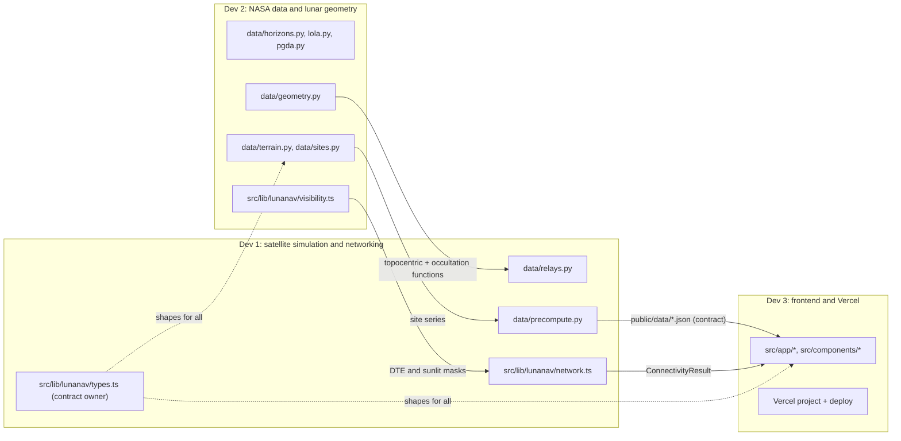
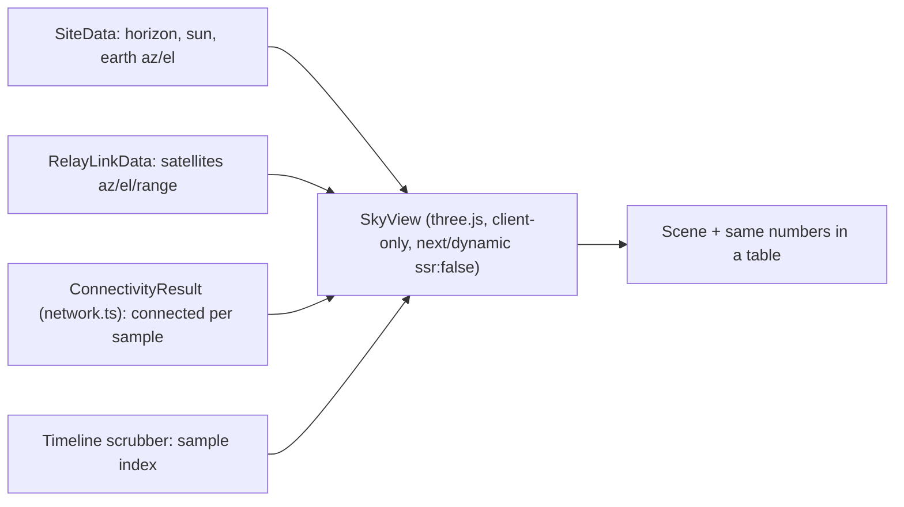

# Architecture: LunaNav, Lunar Communication Network Planner

Status: **proposed** (see [decisions.md](decisions.md), D-10 to D-17). Data shapes: [data-contracts.md](data-contracts.md).

## In one paragraph

LunaNav is a **static-first** Next.js app hosted on **Vercel**. All heavy science runs **offline in
Python** (uv): Horizons ephemeris, LOLA terrain horizons, relay-orbit propagation and the geometry
that turns all of it into per-site azimuth/elevation series. That pipeline writes compact JSON into
`public/data/`, which is committed and served by Vercel's CDN. The browser loads one site file and
one relay file. It then evaluates, sample by sample, whether a **complete path to Earth** exists
(direct, or via a relay), and computes coverage % and blackout intervals. No backend, no database,
no Python on Vercel.

## Where computation happens

| Step | Where | Why there |
|---|---|---|
| Horizons queries, DEM reading, horizon ray-casting, Kepler propagation, Moon-fixed → topocentric conversion, relay–Earth occultation | **Python, offline** (`data/`) | Slow, needs network or rasterio/NumPy, deterministic: compute once |
| Terrain mask lookup, minimum-elevation mask, path logic (DTE OR relay), coverage %, blackout intervals, sunlight fraction, slicing to the chosen date and duration | **Browser** (`src/lib/lunanav/`) | Cheap boolean and array work (~13k samples). Lets the user change date, duration, elevation mask and relay config instantly |
| Formatting, charts, comparison | **Browser** (`src/components/`, `src/app/`) | Render only, no math |

---

## 1. Vercel static-first deployment

- `next.config` uses `output: "export"`. Vercel framework preset: **Next.js**, install `bun install`,
  build `bun run build`. Python is never run on Vercel. `pyproject.toml` at the root is ignored by the
  Next.js preset (verify at F1).
- Every PR gets a Vercel preview URL. `main` is production and is the demo.

## 2. NASA data preprocessing pipeline (offline)

```mermaid
flowchart TB
  subgraph SRC["Sources (cached in data/raw/, gitignored)"]
    H1["Horizons observer tables: Sun, Earth az/el at each site"]
    H2["Horizons Moon-fixed Earth track: sub-Earth lat, lon, range"]
    D1["LOLA LDEM_75S_120M: 120 m, to 75S"]
    D2["PGDA 5 m site DEMs: near field"]
    RC["relays.csv: orbital elements + sources"]
  end
  H1 --> SITE["data/sites.py: sun/earth series per site"]
  D1 --> TER["data/terrain.py: 360-degree horizon profile, near field from 5 m, far field from 120 m, plus lunar curvature"]
  D2 --> TER
  RC --> ORB["data/relays.py: two-body propagation, Moon-fixed positions"]
  H2 --> ORB
  ORB --> GEO["data/geometry.py: Moon-fixed to topocentric az/el; relay-Earth occultation"]
  TER --> PRE["data/precompute.py: validate + write JSON"]
  SITE --> PRE
  GEO --> PRE
  PRE --> J1["public/data/index.json"]
  PRE --> J2["public/data/sites/SITE.json"]
  PRE --> J3["public/data/relays/SITE/CONFIG.json"]
```

Every output carries a `provenance` block (exact query or product) and an `uncertainty` block.

## 3. Lunar orbit and relay network computation (offline, per relay config)

Occultation test, with **s** the satellite position and **ê** the Earth unit vector (Earth treated as
infinitely far, which holds at 384,000 km): visible if `s·ê ≥ 0`, otherwise visible if `|s − (s·ê)ê| > R`.

**Documented shortcuts** (marked in code as `// shortcut:`):
- **Two-body orbits:** no J2 and no Earth third-body perturbation. Frozen orbits are chosen to stay stable, so this holds for coverage statistics but not for operations.
- **Simplified Moon rotation:** uniform spin, ignoring physical libration. Earth's libration is still captured, because the Earth vector comes from Horizons.
- **Queqiao-2's argp/RAAN are unknown.** Per `relays.csv`, argp = 90° (apolune over the south pole) and RAAN is a stated assumption.

## 4. Direct versus relay communication (browser, per sample *t*)

- **Connected means a complete geometric path.** The lander seeing a relay that can't see Earth does **not** count.
- **Geometric visibility is not guaranteed connectivity.** There's no link budget, no DSN scheduling, no inter-satellite links. The UI says this next to every metric.

## 5. User request and browser-side analysis

## 6. Ownership and integration boundaries

**Integration contracts** (each owned by one person; change only in a PR the other two have seen):

| Boundary | Producer → consumer | Contract |
|---|---|---|
| Site series | Dev 2 → Dev 1 | `SiteData` in [data-contracts.md](data-contracts.md) |
| Geometry functions | Dev 2 → Dev 1 | `geometry.topocentric(site, positions_km)`, `geometry.sees_earth(positions_km, earth_unit)` |
| JSON files | Dev 1 → Dev 3 | `DatasetIndex`, `SiteData`, `RelayLinkData` |
| Browser masks | Dev 2 → Dev 1 | `visibility.ts` functions returning `Uint8Array` / `Float32Array` |
| Analysis result | Dev 1 → Dev 3 | `ConnectivityResult` |

## Size and performance budget

- **Supported window (proposed, "To decide at H0" in decisions.md):** 2027-01-01T00:00Z → 2027-04-01T00:00Z at a 10-minute step, which is 12,961 samples.
- **File sizes:** a site file is about 0.4 MB; a relay file is about 0.3 MB per satellite. Values are rounded to 0.01°. Vercel gzips both.
- **Total budget:** under 10 MB in `public/data/`, and no single file over 2 MB.
- **Browser cost:** about 13k samples × a few satellites of boolean work, under 50 ms. No web worker is needed.

## 7. 3D lander sky view (F7, P1, D-21)

The scene is the lander's local sky: azimuth/elevation map directly to a dome around the viewer. It adds
no data and no contract field. Satellite distance is not to scale (labelled). It never computes a
metric: link colour and numbers come from `network.ts`. Cost: `three`, `@react-three/fiber`,
`@react-three/drei`, loaded only on the client so `output: "export"` still builds.
